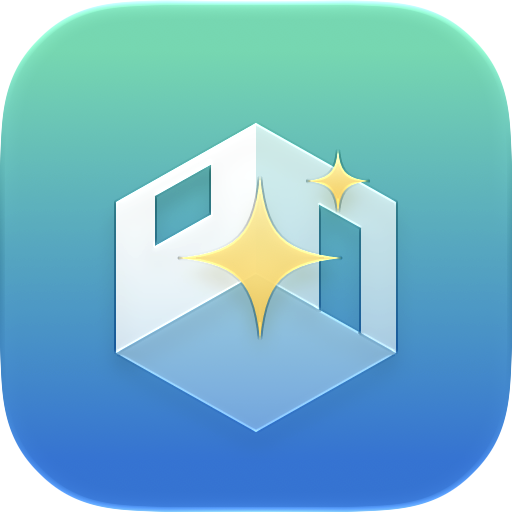
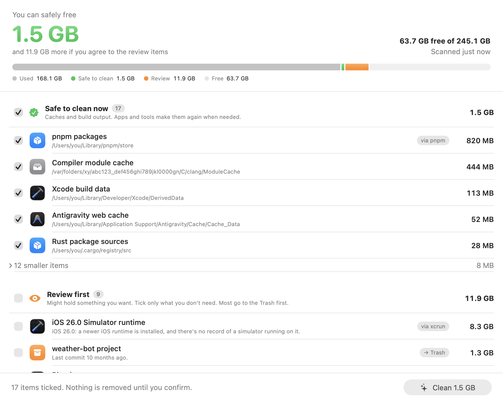
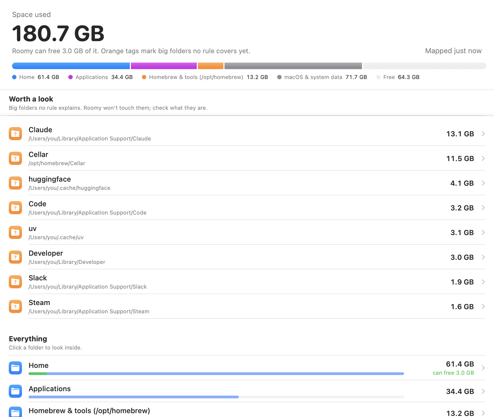
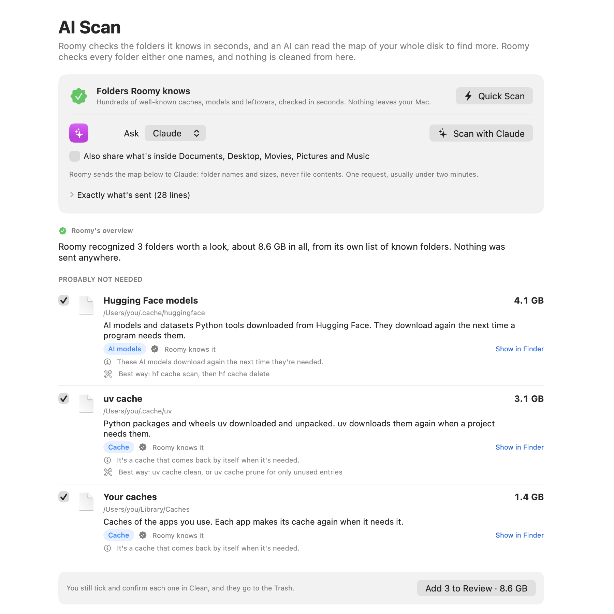
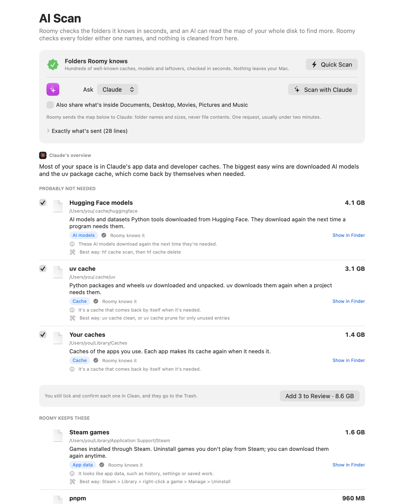
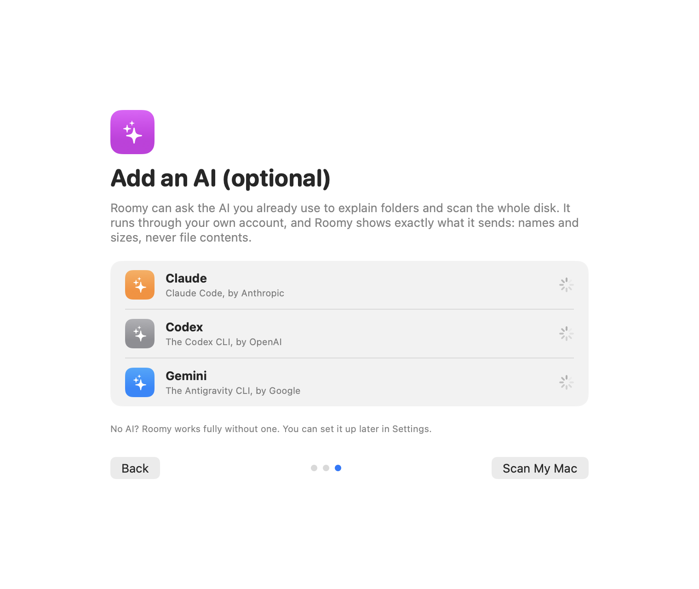
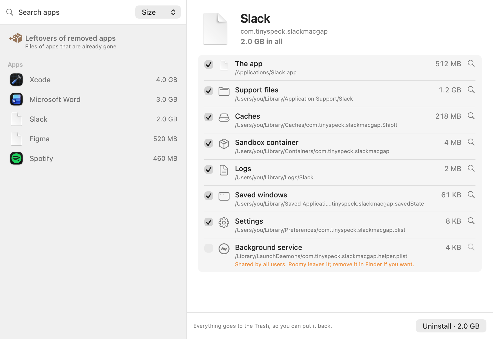
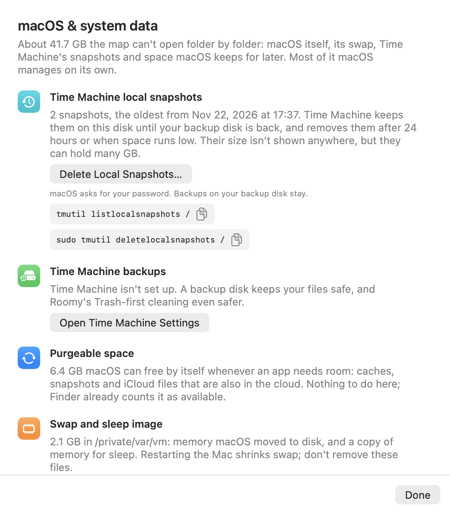
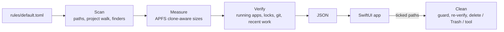

<p align="center">
  
</p>

<h1 align="center">Roomy</h1>

<p align="center">
  <b>Make room on your Mac without the guesswork.</b><br>
  A native macOS cleaner that shows what it will free, explains why it's safe, and does it in one click.
</p>

<p align="center">
  
  
  
  
</p>

<p align="center">
  <picture>
    <source media="(prefers-color-scheme: dark)" srcset="docs/images/window-dark.png">
    
  </picture>
</p>

---

## Why Roomy

Most Mac cleaners find a few gigabytes of caches, inflate the number, and ask you to trust them. When an AI agent was asked to clean the same Mac by hand, it freed **44 GB**, by looking at what was actually there: build folders in old projects, simulator runtimes, duplicate toolchains, stale caches.

Roomy brings that careful, look-before-you-delete approach to an app you can run any time:

- **Honest numbers.** Sizes are measured the way APFS actually stores files. A folder that looks like 3 GB but shares most of its blocks with clones frees only what's really private, and Roomy says so.
- **Every item explained.** What it is, why it's safe, and exactly what Clean will do: delete it, move it to the Trash, or run the tool's own cleanup command.
- **Checks before it touches anything.** Caches stay put while their app runs. A build folder git doesn't ignore goes to Review. A project you worked on today keeps its `node_modules`.
- **No scareware.** No red warnings, no "your Mac is at risk". The big number is what will really be freed.

## Features

### Clean

Everything Roomy finds lands in one of three groups:

| | Group | What happens |
|---|---|---|
| ✅ | **Safe to clean now** | Caches and build output that apps and tools recreate on their own. Ticked by default. |
| 👁️ | **Review first** | Things that are *probably* unneeded but are your call: old projects, unused apps, simulator runtimes, old installers. Unticked by default; most go to the Trash. |
| 🔒 | **In use right now** | An app or tool is using it. Roomy shows which one, with a **Quit** button where it helps. |

Click Clean, confirm, and Roomy cleans item by item, re-checking each one at that moment. It then shows a summary of the space freed and scans again, because freeing one thing can make another freeable.

### Space Map

<p align="center">
  <picture>
    <source media="(prefers-color-scheme: dark)" srcset="docs/images/map-dark.png">
    
  </picture>
</p>

Where does the disk actually go? The Space Map adds up every folder on the disk: your home, Applications, Homebrew, /Library and system data in /private, each byte once (about 16 seconds on a 250 GB Mac). With Full Disk Access it can read nearly all of it. It then shows:

- how much each folder takes, and how much of it Roomy can free (in green);
- **Worth a look:** big folders that no rule explains. Roomy never touches these, but they're where the remaining space hides;
- the part macOS manages itself (system data, snapshots, swap), so the numbers add up.

### Folders Roomy knows

<p align="center">
  <picture>
    <source media="(prefers-color-scheme: dark)" srcset="docs/images/quick-scan-dark.png">
    
  </picture>
</p>

Most big folders on a Mac are well known: uv's cache, Hugging Face models, Xcode's DerivedData, simulators, Docker's disk, Chrome's built-in AI model, Claude's virtual machine. Roomy ships a list of about 390 of them ([`rules/known.toml`](rules/known.toml)). The list covers macOS and Apple's tools, Homebrew, every common language's caches, containers and VMs, AI models and AI coding tools, editors, browsers, chat and office apps, games and media apps. General patterns catch any app's caches, logs and update downloads.

- **Quick Scan** in the AI Scan tab checks the whole map against the list in seconds, with no AI and nothing sent anywhere. On the Mac above it explains 97% of the folders over 100 MB.
- **What is this?** answers a known folder at once and says the best way to free it (`uv cache clean`, `hf cache delete`, Xcode's Components settings). You can still ask an AI for more.
- **The AI Scan** sees the names too, so it spends its time on what Roomy doesn't know, and Roomy's own label wins for folders it knows.
- The same limits apply as for the AI: a running app's folder, your own folders, databases and git repositories are kept. Your files, app data, developer tools and what macOS manages are never suggested.

Add your own in `~/Library/Application Support/Roomy/known.toml` (yours win), or send a pull request. `roomy known <folder>` shows what Roomy knows about any path.

### AI Scan: the whole Mac at once

<p align="center">
  <picture>
    <source media="(prefers-color-scheme: dark)" srcset="docs/images/ai-scan-dark.png">
    
  </picture>
</p>

Instead of asking about folders one by one, let an AI read the map of the whole disk in one request and suggest what could go. It uses the AI you already have: **Claude** (Claude Code), **Codex** (the Codex CLI) or **Gemini** (the Antigravity CLI, `agy`), on your own subscription or API key. There's no Roomy account and no key to paste.

- **It asks first.** You see *exactly what's sent* before you press **Scan**: folder names and sizes, never file contents. Paths start at `~`, so your username isn't sent. Documents, Desktop, Movies, Pictures and Music go as totals only, unless you turn on sharing their contents.
- **Cheap, fast models.** Roomy asks for each AI's cheapest fast model: Claude Haiku, Codex's "fast and affordable" model (GPT-6-Luna today, read from Codex's own model list) with low reasoning, and Gemini Flash. Explaining folders is an easy task, so it uses less of your plan and answers sooner. In Settings > AI, each AI has its own model picker, filled from the tool itself (`codex debug models`, `agy models`; for Claude Code, Haiku, Sonnet and Opus). Pick any model, or the tool's own default.
- **Locked down.** Claude runs with no tools, no MCP servers and no saved session. Codex and Gemini run in their read-only sandboxes. Each runs in an empty temporary folder.
- **Roomy checks every answer.** Paths that aren't on the map, duplicates and folders inside another suggestion are dropped. Roomy then inspects each folder for real and makes the call itself with fixed rules. The AI only says what a folder is and whether it comes back by itself.
- **Hard limits.** Data of running apps, folders with databases, your own folders and git repositories are always kept. "Leftover of a removed app" needs proof that the app is gone.
- **You decide.** Tick what you agree with and **Add to Review**. The folders then show up under *Review first* in Clean and go through every normal check, your confirmation and the Trash. AI never deletes anything.

On a real Mac with 196 GB used, Gemini answered in 17 s, Claude in 36 s and Codex in 87 s. They suggested 9, 8 and 12 folders to review, all caches, installers or leftovers that come back by themselves.

### What is this folder?

In Space Map, every folder has a **What is this?** button. For a folder on Roomy's list, it answers at once. For any other folder, it shows Roomy's own facts (owner, last change, file types, biggest items) and, if you ask, the AI's reading of them, with the same checks as above.

### Set up in a minute

<p align="center">
  
</p>

The first launch walks you through it:

1. **Full Disk Access**, so Roomy can map the whole disk, including other apps' containers and system data. Roomy opens the right page in System Settings and notices when it's on.
2. **An AI, if you want one.** Roomy finds Claude, Codex and Gemini wherever they're installed and shows whether each is signed in. **Install** and **Sign In** open Terminal with the official command, or the official page. **Use** picks the one Roomy asks.

Both are in Settings too, under the gear button next to Scan Again.

### Uninstall apps completely

<p align="center">
  <picture>
    <source media="(prefers-color-scheme: dark)" srcset="docs/images/uninstall-dark.png">
    
  </picture>
</p>

Dragging an app to the Trash leaves its files behind: support files, caches, sandbox containers, settings, saved windows, logs and login items. The **Uninstall** tab finds them all, matched by the app's bundle id and exact name, never by a loose guess.

- Pick an app to see everything it keeps and how big it is. Untick anything you want to keep, then **Uninstall**. It all goes to the Trash.
- An app that's open has to be quit first (Roomy can ask it to quit).
- Files in the shared `/Library` (background services, helper tools) are listed but left for you, because removing them needs an administrator.
- **Homebrew & command-line tools** lists Homebrew formulae and apps, and global npm, uv and pipx tools, by size. Each is removed with its own manager (`brew uninstall`, `npm uninstall -g`, `uv tool uninstall`, `pipx uninstall`), so nothing gets out of sync. Packages other packages need can't be removed, and one button runs `brew autoremove` for dependencies nothing needs anymore.
- **Leftovers of removed apps** finds files named after apps that aren't on the Mac anymore. Apps are found through Spotlight, wherever they are. Apple's own files, building blocks other apps share, login items and anything from a company that still has an app installed are skipped.
- Apple's apps are never offered.

### What's in System Data

<p align="center">
  
</p>

Click **macOS & system data** at the bottom of the Space Map to see what it holds:

- **Time Machine local snapshots.** When your backup disk isn't connected, Time Machine keeps hourly snapshots on your Mac. They can hold many GB, and macOS never shows their size. Roomy lists them and can delete them; macOS asks for your password. Backups on your backup disk aren't touched.
- **Time Machine backups:** whether a backup disk is set up, with a button to its settings.
- **Purgeable space:** what macOS frees by itself when it needs room. There's nothing to do about it.
- **Swap and the sleep image:** memory macOS moved to disk. Restarting shrinks swap.
- **macOS itself:** a sealed, read-only volume with one snapshot for updates. It can't be removed.

### Menu bar

<p align="center">
  <picture>
    <source media="(prefers-color-scheme: dark)" srcset="docs/images/menubar-dark.png">
    
  </picture>
</p>

- Free space at a glance, updated every minute.
- **Clean Safe Items** in two clicks.
- Optional alert when free space drops under 10 GB (at most once a day).
- Optional open at login.

## What it finds

65 rules ship with Roomy, plus built-in **finders** for things a path pattern can't describe.

| Area | Examples |
|---|---|
| **Package managers** | npm, pnpm, Yarn, Bun, uv, pip, Cargo, Go, Gradle, CocoaPods, Deno, Homebrew, Playwright browsers |
| **Build output** | `node_modules`, `target`, `.next`, `.venv`, `dist`, `build`, `.build`, `Pods`, `.godot`… in every project under your home folder |
| **App caches** | Web caches of Electron and Chromium apps (Slack, Notion, Discord, VS Code…), sent crash reports |
| **Browsers** | Chrome, Brave, Edge, Arc, Vivaldi and Firefox page caches (never history, logins or tabs) |
| **Xcode** | DerivedData, old device support files, archives, simulator caches, **unused Simulator runtimes** (5–10 GB each), **a beta runtime once its final release is installed**, broken simulators |
| **Old projects** | Whole git projects untouched for 6 months, but only when every file is committed and every commit is pushed |
| **Git** | Unpacked objects that `git gc` packs together |
| **Unused apps** | Apps not opened in 4 months, using the last-opened date macOS keeps |
| **Unused tools** | Global npm, uv and pipx tools whose commands haven't run in 2 months, going by when their files were last read. Removed with `npm uninstall -g`, `uv tool uninstall` or `pipx uninstall` |
| **Big forgotten files** | Files over 500 MB in Downloads, and disk images, installers, app packages and archives in Desktop and Documents, not opened in 6 months. Always under Review, never ticked for you, and they go to the Trash. Your documents, photos and videos are never listed |
| **Leftovers** | Updater downloads, unfinished downloads, old installers in Downloads, old tool versions, temp-folder leftovers |

<p align="center">
  
</p>

## Safety

Roomy is built so that a bug in a rule can't become a deleted Documents folder.

- **It only cleans what a rule found.** You can't point it at an arbitrary folder.
- **A hard guard on every path.** Roomy never touches your home folder, its main folders (Documents, Desktop, Library…), symlinks or paths that go through a symlink, even if a rule matched them by mistake. Apps can only leave `/Applications` as a whole bundle, and only to the Trash.
- **Checks run twice:** at scan time, and again right before each item is cleaned, against a fresh list of running processes.
- **Tools clean their own data.** Where a tool has a cleanup command (`brew cleanup`, `pnpm store prune`, `xcrun simctl runtime delete`), Roomy runs it with a time limit instead of deleting files under the tool.
- **Some things never go to the Trash.** A `.git` folder or a simulator runtime is only ever handled by its own tool, even with "Move to Trash instead" turned on.
- **AI only suggests.** An AI suggestion becomes a Review rule only when you accept it, and Roomy refuses to suggest your own files, installed apps' data or git repos.
- **Review items always need you.** They're never ticked for you, and most go to the Trash, not straight to deletion.
- **Everything is logged** to `~/Library/Logs/Roomy/clean.jsonl`.

## Install

**Download:** get `Roomy-<version>.dmg` from [Releases](https://github.com/jurek-zsl/Roomy/releases/latest), open it and drag Roomy to Applications. It's signed with a Developer ID and notarized by Apple, so it opens without warnings. It runs on macOS 14 or later, on Apple silicon and Intel Macs.

**Build from source:** you need Xcode 16+, [Rust](https://rustup.rs), and [XcodeGen](https://github.com/yonaskolb/XcodeGen) (`brew install xcodegen`).

```bash
git clone https://github.com/jurek-zsl/Roomy.git
cd Roomy/app
xcodegen generate
xcodebuild -project Roomy.xcodeproj -scheme Roomy -configuration Release -derivedDataPath build build
open build/Build/Products/Release/Roomy.app
```

The Xcode build also compiles the Rust engine and bundles it into the app. On the first scan, macOS asks for access to Documents, Desktop and Downloads; Roomy needs it to find build folders in your projects.

**Updates:** from 0.7.0 on, Roomy checks for new versions about once a day with [Sparkle](https://sparkle-project.org) and asks before installing one. Turn it off or check now in Settings, or use Roomy > Check for Updates. Each update is verified against Roomy's public key, so only updates signed by the developer install.

To make a signed, notarized DMG yourself: `ROOMY_SIGNING_IDENTITY="Developer ID Application: …" ROOMY_NOTARY_PROFILE=<notarytool profile> scripts/release.sh`. Release builds are universal (Apple silicon and Intel). The script also writes `dist/appcast.xml`, signed with the Sparkle key in your keychain; upload it to the GitHub release next to the DMG, since the app reads it from the latest release.

> Roomy is not sandboxed: the sandbox would hide the very caches it cleans. That also means it can't ship on the Mac App Store.

## Command line

The engine is a standalone CLI, and everything the app does works from the terminal too.

```bash
cargo build --release
./target/release/roomy scan                     # what can be freed, grouped and explained
./target/release/roomy map                      # where your disk space goes
./target/release/roomy clean --safe             # clean everything in "Safe now" (asks first)
./target/release/roomy clean node-modules       # one rule
./target/release/roomy clean ~/code/old-app     # the safe items in one folder
./target/release/roomy clean --safe --trash     # move to the Trash instead of deleting
./target/release/roomy inspect ~/.cache/foo     # facts about one folder: owner, types, last change
./target/release/roomy known ~/.cache/uv        # what Roomy's list of known folders says it is
./target/release/roomy uninstall /Applications/Slack.app           # the app and every file it keeps
./target/release/roomy uninstall /Applications/Slack.app --remove  # move them to the Trash
./target/release/roomy leftovers                # files of apps that are already gone
./target/release/roomy packages                 # Homebrew, npm, uv and pipx packages by size
./target/release/roomy rules                    # list every rule
```

```text
$ roomy map --depth 1          # trimmed
Used 180.7 GB · mapped 112.0 GB · macOS, system data and snapshots ~68.7 GB
Roomy can free 3.0 GB of it.

  61.4 GB  ~   can free 3.0 GB
  30.2 GB    Library   can free 1.0 GB
   8.3 GB    Documents   can free 739 MB   your files
   7.2 GB    .cache
           …
  34.4 GB  /Applications
  13.2 GB  /opt/homebrew
```

## How it works



- **Rules** (`rules/default.toml`). Each kind of junk is one rule: a path pattern, a folder name next to a marker file (`target/` next to `Cargo.toml`), or a built-in finder. A rule also carries an explanation, a risk level, the checks to run and the clean command.
- **Scan** (`src/scan.rs`, `src/finders.rs`). Checks fixed locations, walks your home folder in parallel for build folders and git repos, and runs the finders (Spotlight dates for apps, `git` for projects, `simctl` for simulators).
- **Measure** (`src/size.rs`). Uses `getattrlist` with `ATTR_CMNEXT_PRIVATESIZE` to count only the blocks a folder doesn't share with APFS clones. Hard links are counted once.
- **Verify** (`src/verify.rs`). Runs `not-running`, `app-not-running`, `lock-free`, `git-ignored`, `npx-idle` and `project-idle` checks, which sort each item into Safe, Review or Blocked.
- **Clean** (`src/clean.rs`). Re-checks each item, applies the path guard, then deletes it, moves it to the Trash (`renamex_np` with `RENAME_EXCL`, so nothing is ever replaced), or runs the tool's command in its own process group with a timeout.
- **App** (`app/`). SwiftUI with `@Observable`, a window plus a `MenuBarExtra`. The app never decides what's junk; it shows the engine's decisions and passes back the exact paths you ticked.

### Add your own rules

```toml
[[rule]]
id = "my-render-cache"
name = "Render cache"
category = "app-cache"
risk = "safe"
explain = "Preview renders from my video tool. It makes them again."
match = { path = "~/Movies/MyTool/RenderCache" }
verify = ["not-running:MyTool"]
clean = "rm -rf {path}"
```

```bash
roomy scan --rules my-rules.toml
```

### JSON contract

| Command | Output |
|---|---|
| `scan --json` | `{free_bytes, elapsed_ms, findings[]}`. Each finding has `name`, `section` (`safe-now` / `review` / `blocked`), `method` and `trash_method` (`delete` / `trash` / `command`), and an optional `detail`. |
| `inspect --json <folder>` | `{path, bytes, files, folders, newest_days, types[], biggest[], owner, markers[], known}`: the facts the AI reasons over. `known` is Roomy's own entry (`name`, `owner`, `what`, `kind`, `regrows`, `how`, `inside`, `running`), or null. |
| `known --json <folders…>` | One `known` entry (or null) per folder; the folders don't have to exist. |
| `map --json` | `{total_bytes, used_bytes, free_bytes, mapped_bytes, cleanable_bytes, roots[]}`. Each node has `path`, `name`, `kind`, `bytes`, `cleanable`, `children` and, for folders on Roomy's list, `known`. |
| `clean --json [--trash] -- <paths>` | One event per line: `plan`, then `item`…, then `done` (or `error`). |

## Development

```bash
cargo test                                   # engine: 78 tests (real APFS clones, git repos, locks…)
cd app && xcodegen generate
xcodebuild test -project Roomy.xcodeproj -scheme Roomy -destination 'platform=macOS'
xcodebuild test -project Roomy.xcodeproj -scheme Snapshots -destination 'platform=macOS'
```

The `Snapshots` scheme renders every screen, light and dark, to `app/build/snapshots/` without opening a window. The screenshots above come from it, using made-up sample data.

## Teach Roomy new folders

Roomy knows the folders on the Macs it was tested on. Every Mac has different apps, so the best way to fill the gaps is to let an AI agent look at yours and send what it finds back. Paste this into Claude Code, Codex, Gemini or any agent that can run commands:

```text
You're helping improve Roomy, a Mac cleaner whose code is on GitHub (https://github.com/jurek-zsl/Roomy).
Roomy ships a list of known folders in rules/known.toml. Find big folders on this Mac
that the list doesn't know yet, and add them. Don't delete or change anything on this Mac.

1. Clone the repo and build the engine:
   git clone https://github.com/jurek-zsl/Roomy && cd Roomy && cargo build --release
2. Map the disk: ./target/release/roomy map --json > /tmp/roomy-map.json
   (Give your terminal Full Disk Access first, or many folders stay hidden.)
3. Take every folder of 100 MB or more from the map and run
   ./target/release/roomy known <paths...>
   Keep the folders that print "not on the list", and those only matched by a general
   entry ("An app's data", "An app's cache", "A tool's cache", "An app's sandbox").
4. For each one, find out what it really is: run ./target/release/roomy inspect <path>,
   look at the app or tool it belongs to, and check that tool's documentation or website.
   Don't guess. Never open, read or copy the contents of the person's own files.
5. Add an entry to rules/known.toml in the right section, using the format at the top
   of that file: path (~ for home, never a username), name, owner, what (one or two plain
   sentences ending with a period), kind, regrows, and how if the tool has its own clean
   command. Be honest about kind: anything a person would miss (chats, saves, projects,
   settings) is appData or userFiles, never cache.
6. Run cargo test, and check that ./target/release/roomy known <path> now names each folder.
7. Open a pull request listing each folder you added, its typical size, and the source
   you checked. Leave out usernames, personal file names and anything private.
```

Your pull request helps every Mac that has the same apps.

## Roadmap

- **Shared knowledge:** turn folders an AI explained into entries of the known-folders list, so every Mac gets the answer without AI.
- Rules for more apps and tools. Contributions welcome!
- Duplicate files and similar photos.

## License

Roomy is released under the [MIT License](LICENSE). You can use, change and share it, including in your own projects.
