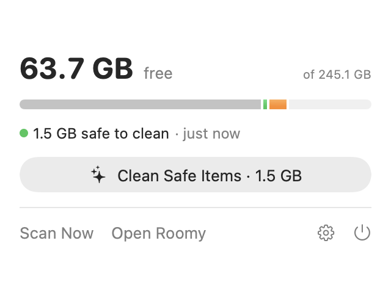
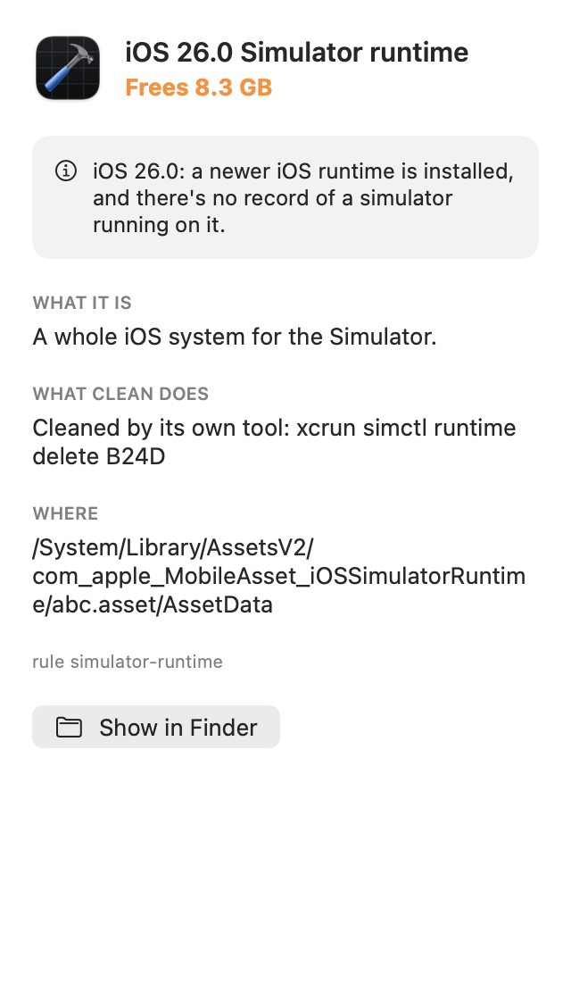
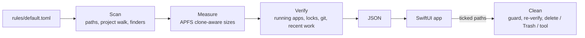

<p align="center">
  
</p>

<h1 align="center">Roomy</h1>

<p align="center">
  <b>Make room on your Mac without the guesswork.</b><br>
  A native macOS cleaner that shows what it will free, explains why it's safe, and does it in one click.
</p>

<p align="center">
  
  
  
  
</p>

<p align="center">
  <picture>
    <source media="(prefers-color-scheme: dark)" srcset="docs/images/window-dark.png">
    
  </picture>
</p>

---

## Why Roomy

Most Mac cleaners find a few gigabytes of caches, inflate the number, and ask you to trust them. When an AI agent was asked to clean the same Mac by hand, it freed **44 GB**, by looking at what was actually there: build folders in old projects, simulator runtimes, duplicate toolchains, stale caches.

Roomy brings that careful, look-before-you-delete approach to an app you can run any time:

- **Honest numbers.** Sizes are measured the way APFS actually stores files. A folder that looks like 3 GB but shares most of its blocks with clones frees only what's really private, and Roomy says so.
- **Every item explained.** What it is, why it's safe, and exactly what Clean will do: delete it, move it to the Trash, or run the tool's own cleanup command.
- **Checks before it touches anything.** Caches stay put while their app runs. A build folder git doesn't ignore goes to Review. A project you worked on today keeps its `node_modules`.
- **No scareware.** No red warnings, no "your Mac is at risk". The big number is what will really be freed.

## Features

### Clean

Everything Roomy finds lands in one of three groups:

| | Group | What happens |
|---|---|---|
| ✅ | **Safe to clean now** | Caches and build output that apps and tools recreate on their own. Ticked by default. |
| 👁️ | **Review first** | Things that are *probably* unneeded but are your call: old projects, unused apps, simulator runtimes, old installers. Unticked by default; most go to the Trash. |
| 🔒 | **In use right now** | An app or tool is using it. Roomy shows which one, with a **Quit** button where it helps. |

Click Clean, confirm, and Roomy cleans item by item, re-checking each one at that moment. It then shows a summary of the space freed and scans again, because freeing one thing can make another freeable.

### Space Map

<p align="center">
  <picture>
    <source media="(prefers-color-scheme: dark)" srcset="docs/images/map-dark.png">
    
  </picture>
</p>

Where does the disk actually go? The Space Map adds up every folder in your home, Applications and Homebrew (about 15 seconds on a 250 GB Mac). It then shows:

- how much each folder takes, and how much of it Roomy can free (in green);
- **Worth a look:** big folders that no rule explains. Roomy never touches these, but they're where the remaining space hides;
- the part macOS manages itself (system data, snapshots, swap), so the numbers add up.

### Menu bar

<p align="center">
  <picture>
    <source media="(prefers-color-scheme: dark)" srcset="docs/images/menubar-dark.png">
    
  </picture>
</p>

- Free space at a glance, updated every minute.
- **Clean Safe Items** in two clicks.
- Optional alert when free space drops under 10 GB (at most once a day).
- Optional open at login.

## What it finds

61 rules ship with Roomy, plus built-in **finders** for things a path pattern can't describe.

| Area | Examples |
|---|---|
| **Package managers** | npm, pnpm, Yarn, Bun, uv, pip, Cargo, Go, Gradle, CocoaPods, Deno, Homebrew, Playwright browsers |
| **Build output** | `node_modules`, `target`, `.next`, `.venv`, `dist`, `build`, `.build`, `Pods`, `.godot`… in every project under your home folder |
| **App caches** | Web caches of Electron and Chromium apps (Slack, Notion, Discord, VS Code…), sent crash reports |
| **Browsers** | Chrome, Brave, Edge, Arc, Vivaldi and Firefox page caches (never history, logins or tabs) |
| **Xcode** | DerivedData, old device support files, archives, simulator caches, **unused Simulator runtimes** (5–10 GB each), broken simulators |
| **Old projects** | Whole git projects untouched for 6 months, but only when every file is committed and every commit is pushed |
| **Git** | Unpacked objects that `git gc` packs together |
| **Unused apps** | Apps not opened in 4 months, using the last-opened date macOS keeps |
| **Leftovers** | Updater downloads, unfinished downloads, old installers in Downloads, old tool versions, temp-folder leftovers |

<p align="center">
  
</p>

## Safety

Roomy is built so that a bug in a rule can't become a deleted Documents folder.

- **It only cleans what a rule found.** You can't point it at an arbitrary folder.
- **A hard guard on every path.** Roomy never touches your home folder, its main folders (Documents, Desktop, Library…), symlinks or paths that go through a symlink, even if a rule matched them by mistake. Apps can only leave `/Applications` as a whole bundle, and only to the Trash.
- **Checks run twice:** at scan time, and again right before each item is cleaned, against a fresh list of running processes.
- **Tools clean their own data.** Where a tool has a cleanup command (`brew cleanup`, `pnpm store prune`, `xcrun simctl runtime delete`), Roomy runs it with a time limit instead of deleting files under the tool.
- **Some things never go to the Trash.** A `.git` folder or a simulator runtime is only ever handled by its own tool, even with "Move to Trash instead" turned on.
- **Review items always need you.** They're never ticked for you, and most go to the Trash, not straight to deletion.
- **Everything is logged** to `~/Library/Logs/Roomy/clean.jsonl`.

## Install

Roomy isn't notarized yet, so build it from source. You need Xcode 16+, [Rust](https://rustup.rs), and [XcodeGen](https://github.com/yonaskolb/XcodeGen) (`brew install xcodegen`).

```bash
git clone https://github.com/jurek-zsl/Roomy.git
cd Roomy/app
xcodegen generate
xcodebuild -project Roomy.xcodeproj -scheme Roomy -configuration Release -derivedDataPath build build
open build/Build/Products/Release/Roomy.app
```

The Xcode build also compiles the Rust engine and bundles it into the app. On the first scan, macOS asks for access to Documents, Desktop and Downloads; Roomy needs it to find build folders in your projects.

> Roomy is not sandboxed: the sandbox would hide the very caches it cleans. That also means it can't ship on the Mac App Store.

## Command line

The engine is a standalone CLI, and everything the app does works from the terminal too.

```bash
cargo build --release
./target/release/roomy scan                     # what can be freed, grouped and explained
./target/release/roomy map                      # where your disk space goes
./target/release/roomy clean --safe             # clean everything in "Safe now" (asks first)
./target/release/roomy clean node-modules       # one rule
./target/release/roomy clean ~/code/old-app     # the safe items in one folder
./target/release/roomy clean --safe --trash     # move to the Trash instead of deleting
./target/release/roomy rules                    # list every rule
```

```text
$ roomy map --depth 1          # trimmed
Used 180.7 GB · mapped 112.0 GB · macOS, system data and snapshots ~68.7 GB
Roomy can free 3.0 GB of it.

  61.4 GB  ~   can free 3.0 GB
  30.2 GB    Library   can free 1.0 GB
   8.3 GB    Documents   can free 739 MB   your files
   7.2 GB    .cache
           …
  34.4 GB  /Applications
  13.2 GB  /opt/homebrew
```

## How it works



- **Rules** (`rules/default.toml`). Each kind of junk is one rule: a path pattern, a folder name next to a marker file (`target/` next to `Cargo.toml`), or a built-in finder. A rule also carries an explanation, a risk level, the checks to run and the clean command.
- **Scan** (`src/scan.rs`, `src/finders.rs`). Checks fixed locations, walks your home folder in parallel for build folders and git repos, and runs the finders (Spotlight dates for apps, `git` for projects, `simctl` for simulators).
- **Measure** (`src/size.rs`). Uses `getattrlist` with `ATTR_CMNEXT_PRIVATESIZE` to count only the blocks a folder doesn't share with APFS clones. Hard links are counted once.
- **Verify** (`src/verify.rs`). Runs `not-running`, `app-not-running`, `lock-free`, `git-ignored`, `npx-idle` and `project-idle` checks, which sort each item into Safe, Review or Blocked.
- **Clean** (`src/clean.rs`). Re-checks each item, applies the path guard, then deletes it, moves it to the Trash (`renamex_np` with `RENAME_EXCL`, so nothing is ever replaced), or runs the tool's command in its own process group with a timeout.
- **App** (`app/`). SwiftUI with `@Observable`, a window plus a `MenuBarExtra`. The app never decides what's junk; it shows the engine's decisions and passes back the exact paths you ticked.

### Add your own rules

```toml
[[rule]]
id = "my-render-cache"
name = "Render cache"
category = "app-cache"
risk = "safe"
explain = "Preview renders from my video tool. It makes them again."
match = { path = "~/Movies/MyTool/RenderCache" }
verify = ["not-running:MyTool"]
clean = "rm -rf {path}"
```

```bash
roomy scan --rules my-rules.toml
```

### JSON contract

| Command | Output |
|---|---|
| `scan --json` | `{free_bytes, elapsed_ms, findings[]}`. Each finding has `name`, `section` (`safe-now` / `review` / `blocked`), `method` and `trash_method` (`delete` / `trash` / `command`), and an optional `detail`. |
| `map --json` | `{total_bytes, used_bytes, free_bytes, mapped_bytes, cleanable_bytes, roots[]}`. Each node has `path`, `name`, `kind`, `bytes`, `cleanable` and `children`. |
| `clean --json [--trash] -- <paths>` | One event per line: `plan`, then `item`…, then `done` (or `error`). |

## Development

```bash
cargo test                                   # engine: 71 tests (real APFS clones, git repos, locks…)
cd app && xcodegen generate
xcodebuild test -project Roomy.xcodeproj -scheme Roomy -destination 'platform=macOS'
xcodebuild test -project Roomy.xcodeproj -scheme Snapshots -destination 'platform=macOS'
```

The `Snapshots` scheme renders every screen, light and dark, to `app/build/snapshots/` without opening a window. The screenshots above come from it, using made-up sample data.

## Roadmap

- **AI for the folders no rule explains.** Ask Claude Code or Codex (using your own subscription or API key) about the "Worth a look" folders. The AI only sees folder names, sizes and dates, never file contents, and it can only suggest Review items. The engine's checks still decide what can be cleaned.
- A signed and notarized download.
- Rules for more apps and tools. Contributions welcome!
